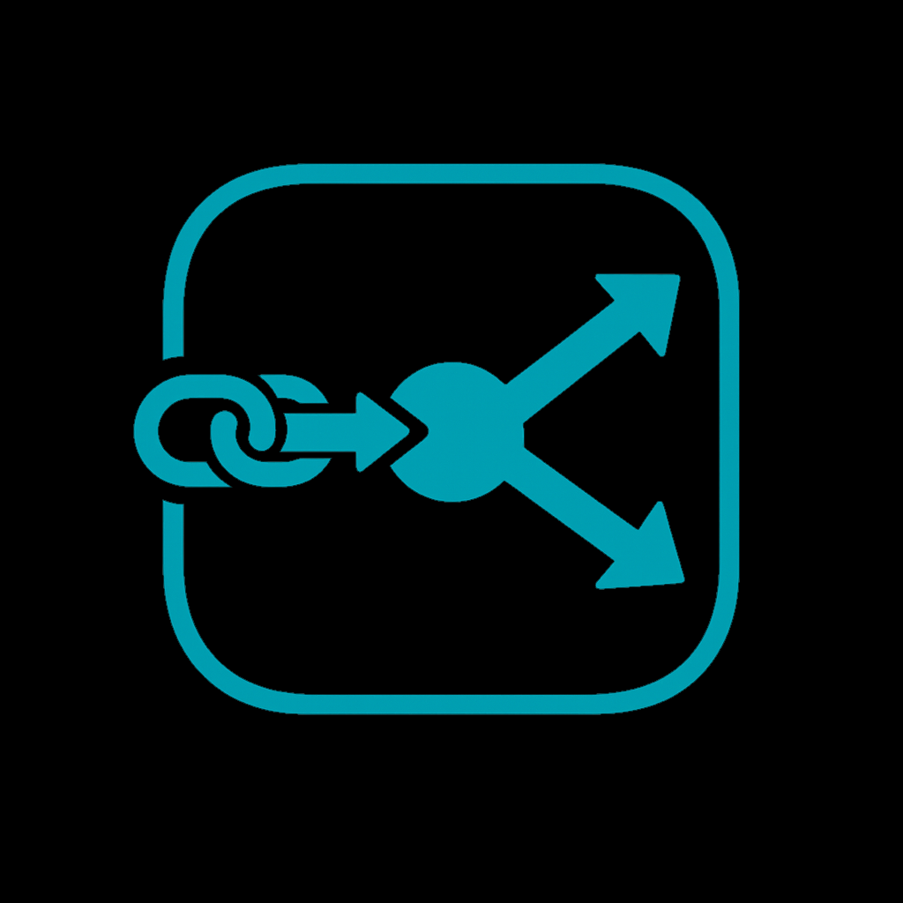

# URL Router

<p align="center">
  
</p>
<p align="center">
  A lightweight Windows app that intercepts links and routes them to the right browser automatically.
</p>

Route every link opened on Windows to the right browser automatically -
based on configurable rules, with a floating chooser popup as fallback.

Portable, no installer, no telemetry, entirely local.

### Instant by design

URL Router lives in the system tray and stays warm. Many similar tools spawn a
fresh process for every link - taking several seconds to start up and show a
window before they can route anything. URL Router doesn't: the running tray
instance handles each link the moment it arrives, so routing and the chooser
popup appear **instantly**, with no cold-start delay.

This is also why the app is built in PyInstaller onedir mode rather than a
single .exe (see the build note below) - onefile would re-extract its archive
on every launch and reintroduce exactly the lag this design avoids.

---

## Quick start

### Prerequisites
- Windows 10 or 11
- Python 3.11+ (only needed to build; the final app has no runtime dependency)

### Build the portable app

```bat
build.bat
```

This installs `PyQt6`, `pywin32`, and `pyinstaller`, then produces a
self-contained folder:

```
dist\URLRouter\
   URLRouter.exe
   _internal\        (bundled Python runtime + Qt - do not separate)
```

Copy the **whole `dist\URLRouter\` folder** anywhere you like (Desktop,
`C:\Tools\`, a USB stick, etc.) and run `URLRouter.exe` inside it.
On first run it writes `config.json` next to the exe - keep it with the folder.

> **Note on the build layout:** the app is built in PyInstaller **onedir**
> mode (a folder), not a single .exe. This is deliberate - onefile mode
> re-extracts the whole archive to a temp directory on *every* launch, which
> added a multi-second delay before the window appeared. Onedir launches
> near-instantly. The trade-off is that `URLRouter.exe` must stay inside its
> `URLRouter\` folder alongside `_internal\`.

> **If you move the folder:** because Windows registers the default browser
> by absolute path, re-confirm URL Router as the default (Settings → General)
> after relocating it.

---

## First-time setup

1. **Run** `URLRouter.exe` - a small icon appears in the system tray.
2. **Right-click the tray icon → Open Settings**.
3. Go to the **Browsers** tab and confirm your browsers were discovered.
4. Go to the **General** tab and click **"Open Windows Default Apps Settings →"**.
5. In Windows Settings, choose **URL Router** as the default browser for HTTP and HTTPS.

From that point on every link opened system-wide - from Slack, Teams, Outlook,
the Start menu, anywhere - is intercepted by URL Router and routed by your rules.

---

## How routing works

When a link is opened, URL Router decides where it goes in this order:

1. **"Never offer" rules** that match hide their browsers from everything below.
2. **The most specific matching rule** → opens in its browser, or ("Always ask")
   shows the chooser.
3. **Default fallback browser** (if you set one and it isn't hidden) → opens there directly.
4. **Otherwise** → shows the chooser popup so you can pick.

### Routing rules

Each rule has:

- **Name** (optional): leave it empty to use an automatic one, such as
  `github.com or gitlab.com → Firefox`.
- **Conditions**: one or more *match type + pattern* lines. The rule applies
  when **any** of them matches.
- **Only when opened from** (optional): limit the rule to links clicked in
  certain apps, for example Slack. Choose **Any app**, **Only these apps** or
  **Any app except these**. This is combined with the conditions: the link must
  match a condition **and** come from one of the apps. A rule limited to apps
  may have no conditions at all, meaning every link from those apps
  (`links from Slack → Chrome`).
- **Action**:
  - **Open in browser**: open in the chosen browser, optionally in a
    **private / incognito window**.
  - **Never offer**: never use the ticked browsers for matching links. Rules
    that would open them are skipped, and they are left out of the chooser.
  - **Always ask**: show the chooser even when a default browser is set,
    optionally offering only the ticked browsers.

Match types, most specific first:

| Tier | Type | Example pattern |
|---|---|---|
| 1 | Exact hostname | `google.com` |
| 2 | Wildcard hostname | `*.youtube.com` |
| 3 | URL prefix | `https://youtube.com/watch` |
| 4 | Contains | `reddit` |
| 5 | Regex | `github\.com/.*/issues` |

When several rules match, the most specific one wins:

1. A rule that matches both the link and the app it came from beats a rule
   that matches only one of them.
2. Then the rule whose matching condition is in the highest tier wins. A rule
   with only an app (no conditions) comes after any rule with a condition.
3. Within the same tier a longer pattern wins (for wildcard, prefix and
   contains).
4. Remaining ties go to the rule higher in the list, which you can change with
   **Up / Down** in **Settings → Rules**.

So `github.com from Slack` beats `github.com`, which beats `links from Slack`.
A leading `www.` is ignored by the hostname types and by URL prefix.

### Which app a link came from

When you click a link, the app you clicked in asks Windows to open it, and
Windows starts URL Router for it. URL Router looks at the program that started
it (Slack, Outlook, Teams, Discord, VS Code...). When that program is only a
Windows helper (Explorer, RuntimeBroker and similar, used by Store apps and
some notifications), it uses the app whose window is in front instead, since
you have just clicked in it.

- When the app cannot be found, rules limited to apps are **skipped**; the
  other rules still apply.
- Apps are identified by their program file name (`slack.exe`). In the rule
  editor, **Add app** offers apps links have already come from, apps with an
  open window, **Browse for a program** and **Type a program name**.
- **Settings → Diagnostics** lists recent links with the app each came from
  and how it was found (`via parent` or `via foreground`).
- Links from Store apps and toasts are a best guess (the window in front), and
  a link opened by a background tool with no click may be credited to whatever
  app is in front.

**Quick rule from the chooser:** when the chooser popup appears, press-and-hold
a browser button for ~0.6 s. URL Router creates an *exact hostname* rule for
that site and browser (a private rule if you held a private button), puts it at
the top of the list and opens the URL. If a quick rule for that site already
exists, it is updated instead. A small toast confirms it.

---

## The chooser popup

Appears when no rule opens the link and no default fallback is set (or it is
hidden by a "Never offer" rule), or when an "Always ask" rule matches. Rules can
narrow which browsers it offers. If another link arrives while it is open, that
link waits and gets its own chooser next.

- Opens on **the monitor where the cursor currently is**.
- Shows the full URL at the top. Click the **pencil** to edit it in place
  before opening; click the **clipboard** icon to copy it.
- The URL field wraps long links and grows up to ~4 lines, scrolling beyond that.
- **Browser buttons** are laid out either horizontally (icon on top, name below)
  or vertically (icon left, name right) - your choice in Appearance.
- **Private / incognito buttons:** any browser you mark as "Private" (Browsers
  tab) gets a second, purple-tinted button with an incognito badge. In
  horizontal layout it sits directly **beneath** the normal button; in vertical
  layout it sits in a **second column** to the right. Clicking it launches that
  browser in private mode (`--incognito`, `--inprivate`, `--private` for Opera,
  or `--private-window` for Firefox-based browsers).
- **Escape** or **clicking outside** the popup dismisses it without opening anything.
- **Hold** a browser button (~0.6 s) → creates a rule + opens the URL + toast.

---

## Settings tabs

| Tab | What you can do |
|---|---|
| **Browsers** | Enable/disable browsers, mark browsers for a **Private** button, set display order, designate a default fallback, rescan for newly installed browsers, edit display names inline |
| **Rules** | Add · Edit (or double-click) · Delete · Reorder routing rules; enable/disable with the checkbox |
| **Appearance** | Chooser position, background colour & opacity, corner radius, padding, icon size, label font size, URL font size, layout (horizontal/vertical), show/hide icons & names - all with a **live preview** beside the controls |
| **General** | Launch on startup, open Windows Default Apps settings |
| **Import / Export** | Export config to JSON, import from JSON, reset appearance & rules to defaults |
| **Diagnostics** | Paste any URL, optionally pick the app it was opened from, and see what would happen and why, step by step: hidden browsers, every rule tested, the winner, default fallback or chooser. Also lists recent links and the app each came from; double-click one to test it |

### Live appearance preview

The Appearance tab shows a **real-time preview** of the actual chooser popup
on the right side of the tab (not a mock-up). It renders a genuine chooser
using your real browsers, icons, colours, and layout, and updates instantly as
you drag any slider or toggle any option - including changes made on the
Browsers tab (enabling a browser, toggling Private). The controls scroll
independently on the left while the preview stays pinned in view.

### Appearance options explained

- **Padding** controls both the margin between the buttons and the popup edge,
  *and* the spacing between buttons.
- **Label font size** sizes the browser names; **URL font size** is independent
  and sizes the URL field text.
- **Popup width** can be a fixed pixel value, or `0` for **auto** - the popup
  sizes itself to fit the browser buttons (accounting for private columns/rows).
- Each browser button sizes to fit whichever is larger, its icon or its name.

---

## Technical notes

| Topic | Detail |
|---|---|
| Stack | Python 3.11 + PyQt6, packaged with PyInstaller (onedir) |
| Registry | Writes to `HKCU` only - no administrator rights required |
| Single instance | Windows named mutex; a second launch detects the app the link came from, forwards the URL and that app to the running instance over a named pipe, then exits |
| Config | `config.json` next to the exe - plain JSON, human-editable |
| Startup | Optional `HKCU\...\Run` entry, toggleable in Settings → General |
| App icon | Loads `icon.png` next to the exe if present, else a generated icon; the exe itself is built with `icon.ico` |
| Telemetry | None. Entirely local. |
| Installer | None. Portable folder. |

### Project structure

| File | Role |
|---|---|
| `main.py` | Entry point: single-instance gate, DPI awareness, Qt bootstrap |
| `app.py` | Core app: owns config, IPC server, tray, chooser, settings; routing & browser launching |
| `config.py` | JSON config load/save and defaults; remembers the apps links came from |
| `ipc.py` | Qt-free client side: mutex + send URL (and source app) to existing instance |
| `source_app.py` | Qt-free detection of the app a link was clicked in (parent process / foreground window) |
| `ipc_server.py` | Qt IPC server (first instance only) |
| `registry.py` | Browser discovery, HKCU registration, startup key, Default Apps launcher |
| `router.py` | Rule engine + diagnostics |
| `browser_utils.py` | Browser icon extraction, app icon |
| `theme.py` | Light/dark Qt stylesheets |
| `tray.py` | System tray icon + menu |
| `chooser.py` | Floating chooser popup (URL field, browser/private buttons) |
| `settings_window.py` | Six-tab settings UI + live preview |
| `toast.py` | Corner fade notification |
| `URLRouter.spec` | PyInstaller build spec (onedir) |
| `build.bat` | One-command build script |
| `requirements.txt` | Build/runtime Python dependencies |
| `icon.png`, `icon.ico` | App icons |

---

## Uninstall

1. Exit URL Router (tray → Exit).
2. Open **Windows Default Apps Settings** and choose a different default browser.
3. Delete the `URLRouter\` folder (which contains `URLRouter.exe`, `_internal\`,
   and `config.json`).

Registry entries under `HKCU\Software\Classes\URLRouterHTML` and
`HKCU\Software\Clients\StartMenuInternet\URLRouter` can be removed with
`regedit` if desired, but Windows stops routing to them automatically once a
new default browser is set. If you enabled "Launch on startup", also remove the
`URLRouter` value under `HKCU\Software\Microsoft\Windows\CurrentVersion\Run`
(or just toggle it off in Settings before uninstalling).
